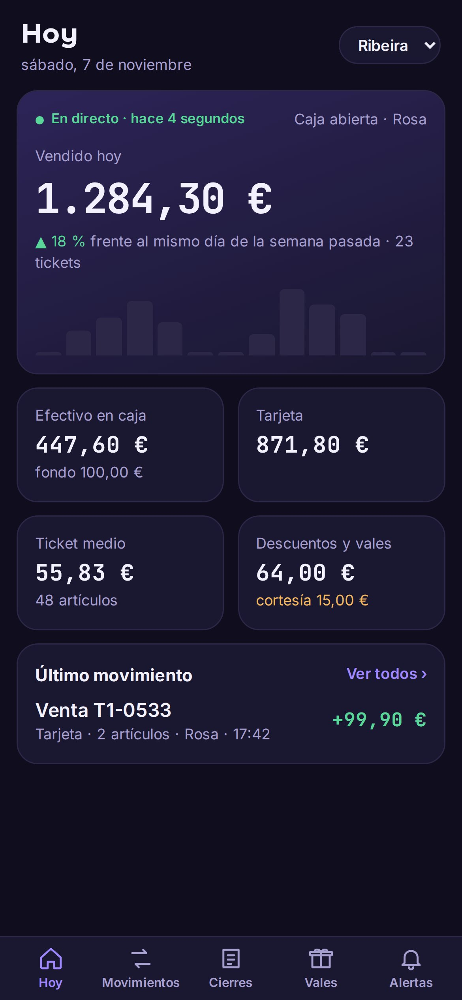
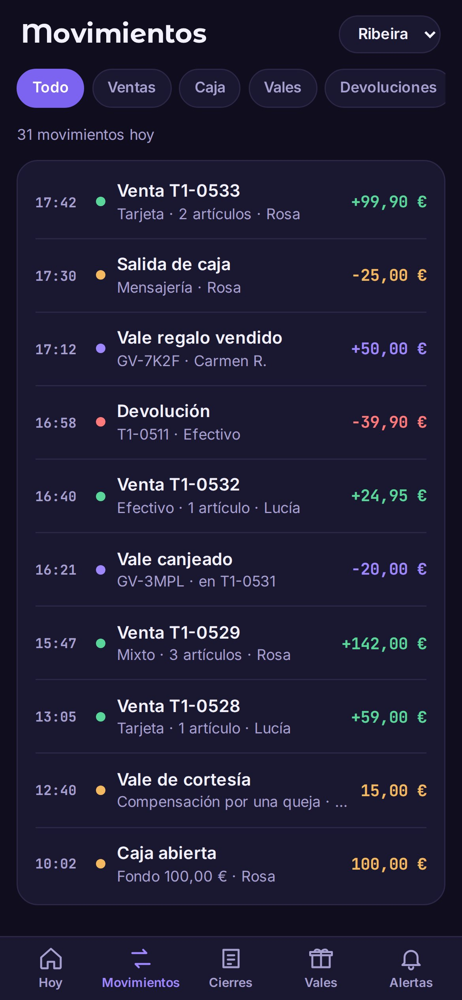
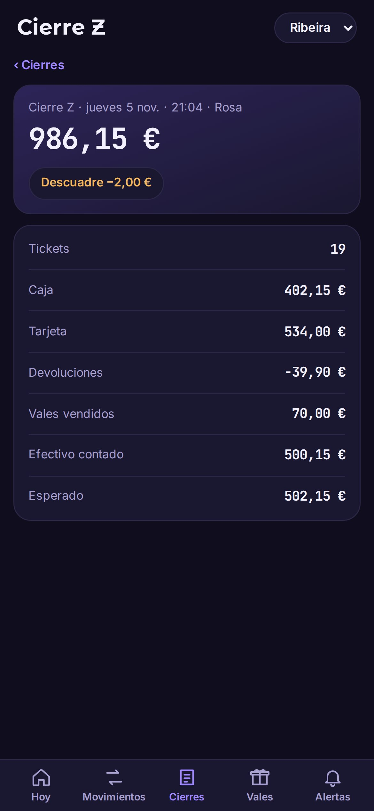
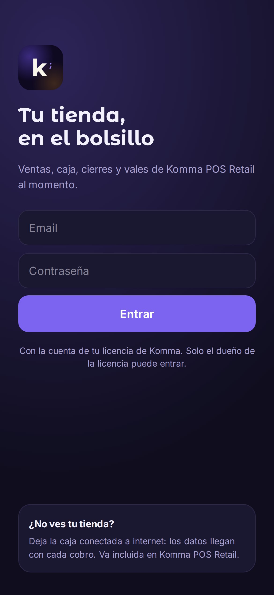
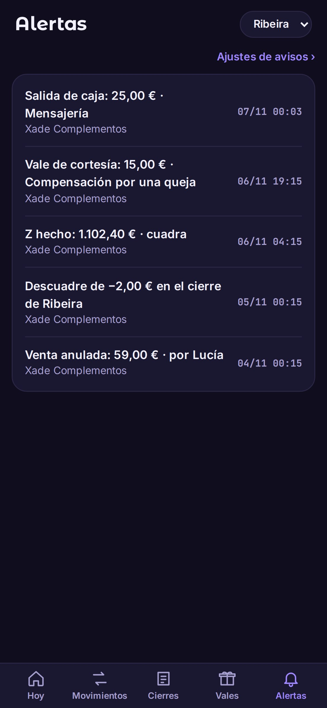
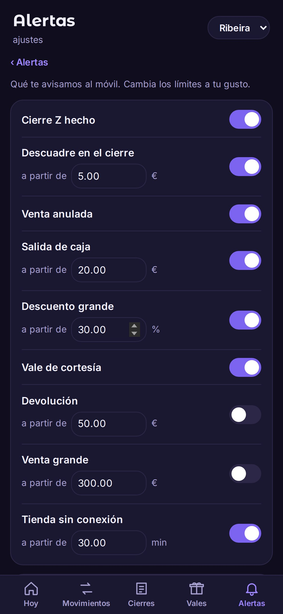

# Komma POS

The phone of the owner of **Komma POS Retail**. It shows what every store has
sold today, the cash that should be in the drawer, every Z closing and the gift
vouchers, as they happen, and sends a notification when something needs the
owner's eye. The figures arrive from the tills; nothing is typed on the phone.

## Download

| System | Download |
| --- | --- |
| **Android 13 or later** | [Latest version](https://github.com/komma-softhouse/komma-pos-owner-android-releases/releases/latest): the `.apk` file |

Every published version is listed under
[Releases](https://github.com/komma-softhouse/komma-pos-owner-android-releases/releases).
Each version also carries its `.sha256` file to check that the `.apk` has not
been altered. The easiest way is to download it from the till itself, in
**Settings → Owner app**, which always links the latest version.

  
  
  

## What it does

- **Today.** Sold so far, compared with the same day last week, sales by hour,
  cash expected in the drawer, card, average ticket, discounts and vouchers.
- **Movements.** Every sale, return, cash in and out and voucher of the day, as
  it happens, filtered by kind and 50 at a time.
- **Closings.** The open till and every Z closing, with the cash counted and
  whether it balances.
- **Vouchers.** The balance still to be spent, vouchers sold and courtesy
  vouchers of the month.
- **Alerts.** A notification when a closing is done or does not balance, a sale
  is voided, cash leaves the drawer, a big discount or a courtesy voucher is
  given, or a store goes offline. The owner chooses which ones, from what amount
  and the quiet hours.
- **Several stores.** Switch between them at the top of the screen.
- **Without network.** If the store loses its connection, the movements wait on
  the till and arrive in order when it comes back.
- **Updates itself.** From **Alerts → Alert settings**, without Google Play.

## Install

1. On the phone, open the
   [latest version](https://github.com/komma-softhouse/komma-pos-owner-android-releases/releases/latest)
   and download the `.apk` file.
2. Open it. If Android asks for permission to install apps from this source,
   allow it for the browser and go back.
3. Tap **Install**. Komma POS appears in the app drawer.

## Getting started

1. **Sign in** with the email and password of the account that owns the
   Komma POS Retail licence.
2. **Allow notifications** when the app asks, so the alerts reach the phone.
3. **Choose your alerts** in **Alerts → Alert settings**: which ones, from what
   amount and the quiet hours.

  
  
  

## Requirements

- Android 13 or later.
- A Komma POS Retail licence with the owner app included.
- Wi-Fi or mobile data on the phone, and internet at the store so the till can
  send its movements.

## Updates

In **Alerts → Alert settings** tap **Check for updates**. If there is a new
version, **Download and install** fetches it, checks that it arrived complete
and opens the Android installer. The first time, Android asks to allow
installing from Komma POS. The phone stays signed in.

## If something fails

When the app meets an unexpected error it shows an incident code and a button
to report it. The report reaches Komma with the code, the version and the
screen, never sales or customer data. If you call support, have the code at
hand.

## Support

Komma SoftHouse · [kommasofthouse.com](https://kommasofthouse.com) · info@kommasofthouse.com
